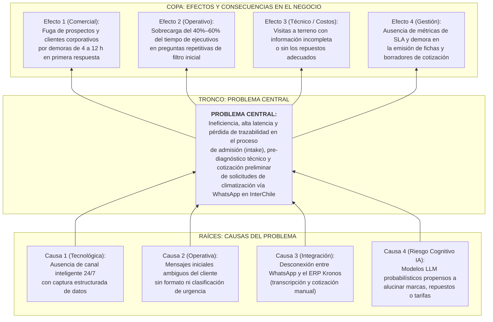

# Análisis del Problema, Objetivo General y Objetivos Específicos (Informe Final de Proyecto de Título)

**Proyecto de Título:** Desarrollo e Implementación de un Agente Autónomo Conversacional de Pre-Diagnóstico Técnico y Triage Comercial Integrado al Sistema ERP Kronos para InterChile Climatización  
**Empresa Contraparte (Stakeholder Real):** InterChile Climatización (Benjamín Yáñez — Gerente Comercial y de Operaciones)  
**Estudiante:** Carlos Gabriel González Salgado  
**Profesora Metodológica:** Sarita González Catalán  
**Profesor Guía Técnico:** Matías Vargas  
**Fecha de Actualización:** 11 de noviembre de 2026  

---

## 1. Fundamentación y Contexto del Problema

**InterChile Climatización** es una empresa chilena dedicada a la venta, instalación, mantención preventiva, reparación de urgencia, proyectos de ingeniería térmica y arriendo de equipos de aire acondicionado y climatización industrial/comercial (unidades *Split*, *Cassette*, *Piso-Techo*, *Ducto*, *Chiller* y sistemas centralizados *VRV/VRF*).

En la operación diaria de la empresa, **WhatsApp Business** constituye el canal primario por el cual ingresan más del 80% de las solicitudes comerciales y de asistencia técnica de clientes residenciales y corporativos (clínicas médicas, oficinas, locales comerciales y plantas). Sin embargo, previo a este proyecto, el proceso de admisión (*intake*), diagnóstico preliminar y perfilamiento comercial dependía de la atención manual de ejecutivos y supervisores humanos sobre conversaciones informales no estructuradas.

Esta modalidad manual genera un cuello de botella crítico:
1. **Asimetría de información inicial:** Los clientes reportan síntomas ambiguos (ej. *"el equipo blanco gotea"*, *"no enfría la sala de procedimientos"*) omitiendo datos indispensables para asignar un técnico o estimar costos: tipo de servicio requerido (entre las 7 líneas de negocio de InterChile), categoría del equipo, marca/modelo, comuna/dirección y urgencia real.
2. **Fricción operativa y latencia de respuesta:** Un ejecutivo humano tarda entre 15 y 40 minutos de intercambio fragmentado de mensajes por cada prospecto solo para recolectar los datos básicos, provocando tiempos de primera respuesta de entre 4 y 12 horas fuera de horario hábil.
3. **Desconexión con el sistema de gestión (ERP Kronos):** Los antecedentes quedan dispersos en el historial de chat del teléfono, obligando a transcribir manualmente los casos hacia el sistema ERP Kronos y a calcular presupuestos preliminares a mano, con riesgo de errores de tipeo, omisión de IVA o pérdida de seguimiento.
4. **Riesgo de alucinación al usar IA generativa sin control:** La simple conexión de un modelo de lenguaje (LLM) comercial sin validación de negocio conlleva el riesgo de que la IA invente repuestos, confirme disponibilidad de marcas que la empresa no trabaja o entregue precios alucinados.

---

## 2. Análisis Estructurado del Problema

Para diagnosticar con rigor metodológico la situación actual (*AS-IS*), se aplicaron de forma complementaria dos herramientas de ingeniería de requerimientos: el **Árbol de Problemas (Árbol Invertido)** y la **Técnica de los 5 Porqués**.

### 2.1. Técnica 1: Árbol de Problemas (Causa – Problema Central – Efecto)

---

### 2.2. Técnica 2: Análisis de los 5 Porqués (Convergencia a la Causa Raíz)

- **Problema Observado:** InterChile Climatización pierde oportunidades comerciales y sufre sobrecarga operativa en la atención de solicitudes por WhatsApp.
  1. **1° ¿Por qué se pierden oportunidades y se sobrecarga al equipo?**  
     Porque los ejecutivos demoran horas en responder, clasificar la urgencia y entregar una primera estimación comercial al cliente.
  2. **2° ¿Por qué demoran horas en clasificar el caso y entregar una estimación?**  
     Porque deben interrogar manualmente a cada cliente turno por turno para averiguar qué servicio necesita, qué equipo tiene, en qué comuna está y cuál es la falla.
  3. **3° ¿Por qué ese levantamiento de datos y cálculo preliminar se realiza manualmente?**  
     Porque el canal de WhatsApp no cuenta con un agente autónomo que guíe la conversación, estructure una ficha técnica validada y calcule el borrador de cotización automáticamente.
  4. **4° ¿Por qué no bastaba con instalar un chatbot tradicional o un LLM genérico?**  
     Porque un árbol rígido no comprende descripciones técnicas abiertas, mientras que un LLM genérico sin control puede alucinar marcas, repuestos o precios que no existen en el inventario de InterChile.
  5. **5° ¿Por qué (Causa Raíz Tecnológica)?**  
     **Por la inexistencia de una plataforma de software de Triage Comercial que combine procesamiento semántico multi-turno (LLM) con arneses deterministas conectados al catálogo del ERP Kronos, motor de cotización exacta en CLP y generación automatizada de fichas técnicas en PDF.**

---

## 3. Definición del Objetivo General y Objetivos Específicos

### 3.1. Objetivo General del Proyecto

> **Objetivo General:**  
> *"Diseñar, desarrollar e implementar un Agente Autónomo Conversacional de Pre-Diagnóstico Técnico y Triage Comercial integrado al ecosistema ERP Kronos para la empresa InterChile Climatización, mediante modelos de lenguaje (Gemini), arneses deterministas anti-alucinaciones y un motor de cotización referencial en PDF, con el fin de automatizar la captura estructurada de requerimientos vía WhatsApp, priorizar urgencias operativas y reducir los tiempos de atención al cliente."*

---

### 3.2. Objetivos Específicos y sus Métricas de Éxito (KPIs)

#### Objetivo Específico 1 (Modelado de Flujos de Triage e Interacción Guiada)
> **OE 1:** *"Analizar y modelar los flujos conversacionales de admisión técnica y perfilamiento comercial, implementando recepción segura de webhooks de WhatsApp Cloud API, menús interactivos para las 7 líneas de servicio de InterChile y reglas de clasificación automática de prioridad (Alta, Normal, Baja) y derivación a ejecutivo humano."*
- **KPI 1.1:** Verificación criptográfica del $100\%$ de los webhooks entrantes mediante firma `HMAC-SHA256` (`401/403` ante firmas inválidas).
- **KPI 1.2:** Cobertura de las 7 líneas oficiales de negocio (`Falla Técnica`, `Mantención`, `Instalación`, `Cotización`, `Proyecto Comercial`, `Arriendo`, `Otra Consulta`) mediante botones y listas interactivas de WhatsApp.
- **KPI 1.3:** Detección y silenciamiento automático del $100\%$ de los casos que solicitan derivación a ejecutivo humano (`requiere_humano = true`, `estado = 'derivado'`).

#### Objetivo Específico 2 (Motor Semántico Multi-Turno y Arneses Anti-Alucinaciones)
> **OE 2:** *"Diseñar e implementar el motor de procesamiento semántico con memoria conversacional multi-turno (LangChain + Google Gemini 2.5 Flash + Zod) y arneses algorítmicos de validación contra el catálogo del ERP Kronos, asegurando la intercepción y sanitización de marcas, tipos de equipo o repuestos no verificados."*
- **KPI 2.1:** Extracción estructurada del $100\%$ de las fichas de triage bajo esquema estricto `Zod` sin errores de parseo.
- **KPI 2.2:** Tasa de intercepción del **$100\%$ de las alucinaciones** de marca, modelo, tipo de equipo o repuesto en `src/arneses.js`, reemplazándolas por `[dato por confirmar]` antes de persistir o responder al cliente.
- **KPI 2.3:** Distinción explícita entre validación oficial del catálogo remoto de Kronos (`GET /api/kronos/catalogo`, timeout $\le 5\text{ s}$, `catalogo_verificado: true`) y lista local de respaldo (`catalogo_verificado: false`).

#### Objetivo Específico 3 (Persistencia Relacional, Cotizador Determinista CLP y Ficha PDF)
> **OE 3:** *"Desarrollar la capa de persistencia transaccional en PostgreSQL (Supabase), el motor determinista de borrador de cotización en pesos chilenos (Subtotal Neto + IVA 19% + Total CLP) y el generador nativo de fichas técnicas en formato PDF estándar (`%PDF-1.4`) para formalizar las estimaciones preliminares sin riesgo de alucinación aritmética."*
- **KPI 3.1:** Exactitud matemática del **$100\%$ en el cálculo de Subtotal Neto, IVA (19%) y Total CLP** en `src/cotizador.js`, retornando `null` (nunca `$0` falso) cuando el equipo no está confirmado.
- **KPI 3.2:** Tasa de éxito del **$100\%$ en la generación y descarga de fichas técnicas en PDF** (`%PDF-1.4`) en `< 5 ms` mediante `src/pdfGenerator.js` con sello explícito *"Estimación del bot · No es presupuesto oficial"*.
- **KPI 3.3:** Preservación de `created_at` inmutable y control de versión mediante `updated_at` en el $100\%$ de las actualizaciones de tickets en `src/db.js`.

#### Objetivo Específico 4 (Integración ERP Kronos 2.0, Dashboard Operativo y Validación de SLA)
> **OE 4:** *"Implementar la interfaz web administrativa de gestión y contingencia operativa (Dashboard Web) junto con el contrato de API autenticado para el ERP Kronos 2.0 (`KRON2-152`), validando el cumplimiento de atributos de calidad (latencia SLA y concurrencia) mediante una suite automatizada de pruebas unitarias, de integración y de estrés."*
- **KPI 4.1:** Latencia promedio de procesamiento del bot **$< 4.0\text{ s}$ ($< 4000\text{ ms}$)** monitoreada en tiempo real en `GET /api/metricas`.
- **KPI 4.2:** Tasa de éxito **$> 99\%$ ($100\%$ medido)** bajo pruebas de estrés y concurrencia con **$N = 20$ usuarios simultáneos**, con cero colisiones de sesión.
- **KPI 4.3:** Protección del $100\%$ de los endpoints administrativos (`/api/tickets`, `/api/tickets/:id`, `PATCH /api/tickets/:id`, `/pdf`, `/metricas`) con Bearer Token privado (`TRIAGE_API_TOKEN`), paginación por cursor `updated_at+id` y bloqueo optimista `409 Conflict`.
- **KPI 4.4:** Aprobación del **$100\%$ de la suite automatizada en Jest (`5 suites / 54 tests PASS`)** y despliegue continuo en la nube en Render con HTTPS/SSL.

---

## 4. Matriz de Consistencia Longitudinal (Objetivos de Tesis vs. Sprints 1, 2 y 3)

| Objetivo Específico del Proyecto | Incremento Sprint 1 (Hito 1: MVP Base) | Incremento Sprint 2 (Hito 2: Diagnóstico, Arnés y Nube) | Incremento Sprint 3 (Hito 3: Cotización PDF, SLA e Integración Kronos 2.0) |
| :--- | :--- | :--- | :--- |
| **OE 1:** Flujos de Triage, Interacción y Derivación | Webhook básico de WhatsApp (`HU-01`) y clasificación inicial de prioridad (`HU-03`). | Menús interactivos de botones/listas con 7 servicios (`HU-20`) y derivación a ejecutivo con silenciamiento (`HU-06`). | Consolidación del flujo E2E bajo ráfagas de 20 usuarios simultáneos (`INT-HU-23`). |
| **OE 2:** Motor Semántico IA y Arneses Anti-Alucinación | Extracción inicial con Gemini y esquema estructurado (`HU-03`). | Memoria conversacional multi-turno (`HU-02`) y arnés determinista anti-alucinaciones (`HU-18` / `HU-21`). | Adaptación al contrato remoto `GET /api/kronos/catalogo` (timeout 5 s, `catalogo_verificado`) y métrica de efectividad del arnés (`INT-HU-22` / `KRON2-152`). |
| **OE 3:** Persistencia, Cotizador CLP y Ficha PDF | Modelo relacional `clientes` y `casos_triage` en Supabase (`HU-04`). | Transacciones con rollback, UPSERT de sesión activa y logs locales de error (`HU-16`). | Motor determinista `src/cotizador.js` (CLP + IVA 19%), generador `src/pdfGenerator.js` (`%PDF-1.4`) e inmutabilidad de `created_at` (`INT-HU-05`). |
| **OE 4:** Integración Kronos, Dashboard y Atributos de Calidad | Entorno local de validación y pruebas iniciales (`17 tests`). | Despliegue 24/7 en Render (`INT-TSK-02`), token permanente Meta (`INT-TSK-01`) y Dashboard v1 (`HU-14`, `34 tests`). | Autenticación Bearer (`TRIAGE_API_TOKEN`), paginación cursor, agendamiento `PATCH` con conflicto `409` (`INT-HU-19`), panel SLA (`INT-HU-22`) e informe formal con `54/54 tests PASS` (`INT-HU-23`). |
