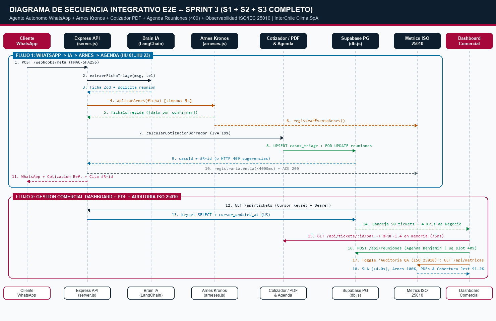
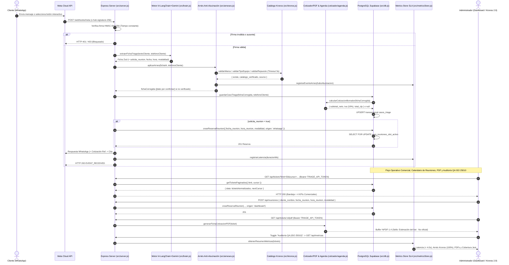

# Arquitectura Integrativa End-to-End, Calidad ISO/IEC 25010 y ADRs — Sprint 3 (Cierre de Titulación)

**Proyecto:** Agente Autónomo de Triage Comercial e Integración ERP Kronos — InterChile Clima SpA  
**Autor:** Carlos Gabriel González Salgado  
**Asignatura:** Proyecto de Título (UNAB) — Sprint 3 / Hito 3  
**Fecha de Actualización:** 23 de noviembre de 2026  

---

## 1. Visión Arquitectónica Integrativa (End-to-End S1 + S2 + S3)

En el Sprint 3 se consolida la arquitectura completa del sistema unificando en un flujo continuo, seguro y trazable:
1. **Recepción Segura de Mensajería (`HU-16` / Webhooks):** Webhook de Meta Cloud API validado criptográficamente en tiempo constante mediante firma `HMAC-SHA256` (`x-hub-signature-256`).
2. **Orquestación Cognitiva con Memoria (`HU-01` a `HU-04`, `HU-20`):** Motor conversacional en `src/brain.js` con LangChain y Google Gemini (`gemini-2.5-flash`) + validación estricta de esquema mediante `Zod`.
3. **Arnés Anti-Alucinaciones y Contrato de Catálogo (`HU-18` / `HU-21` / `KRON2-152`):** Validación previa al guardado en `src/arneses.js` y `src/kronos.js` contra `GET /api/kronos/catalogo` (timeout de `5 s`) o respaldo local controlado (`catalogo_verificado: false`), reemplazando cualquier entidad no verificada por `[dato por confirmar]`.
4. **Motor Determinista de Cotización y PDF (`HU-05` / `AAI-25`):** Cálculo exacto en CLP (Subtotal Neto + IVA `19%` + Total) fuera del LLM en `src/cotizador.js` (impidiendo alucinaciones aritméticas), y generación nativa de ficha técnica corporativa en estándar `%PDF-1.4` (`src/pdfGenerator.js`).
5. **Agendamiento Automático de Reuniones y Prevención de Topones (`HU-23` / `AAI-102`):** Detección de intención `solicita_reunion` desde WhatsApp y motor de bloques horarios (`09:00`–`18:00`) en `src/agenda.js`, respaldado por la tabla `public.reuniones` en Supabase con índice único parcial `uq_reuniones_slot_activo`, bloqueo transaccional `FOR UPDATE` y respuesta `HTTP 409 HORARIO_OCUPADO` con sugerencias de horas libres cercanas.
6. **Persistencia Transaccional y Contrato API (`HU-19` / `KRON2-152`):** Almacenamiento en PostgreSQL (Supabase) con `created_at` inmutable, paginación por cursor estable (`updated_at+id` con preservación de microsegundos), control de concurrencia optimista (`409 Conflict`) y protección mediante Bearer Token privado (`TRIAGE_API_TOKEN`).
7. **Gestión Operativa Separada de Observabilidad ISO 25010 (`HU-14`, `HU-22`, Feedback Sprint Review):** Dashboard corporativo (`public/dashboard.html`) alineado con `interchileclima.cl` que muestra en portada **4 KPIs comerciales de negocio**, bandeja operativa, descarga PDF y **Calendario Interactivo de Reuniones con Benjamín**, aislando los **3 KPIs técnicos de ingeniería** en el panel colapsable **Auditoría QA (ISO/IEC 25010)**.

---

## 2. Diagrama de Secuencia Integrativo E2E

---

## 3. Registros de Decisiones de Arquitectura (ADRs — Sprint 3)

### ADR-01: Motor Determinista de Cotización Desacoplado del LLM (`src/cotizador.js`)
- **Contexto:** Los LLMs pueden cometer errores aritméticos o inventar tarifas al calcular montos netos e IVA (`19%`).
- **Decisión:** El LLM únicamente clasifica intención, equipo y prioridad. Todo cálculo en CLP (`subtotal_neto`, `iva`, `total_clp`) ocurre de manera determinista en `src/cotizador.js`. Si falta equipo (`[dato por confirmar]`) o el servicio requiere levantamiento en terreno, se retorna `null` (nunca `0`).
- **Consecuencia:** Precisión aritmética de `100%` y cero alucinaciones de precios.

### ADR-02: Generación Nativa de PDF `%PDF-1.4` en Memoria (`src/pdfGenerator.js`)
- **Contexto:** Chromium headless consume >300 MB de RAM y arriesga caídas `OOM` en el plan Free de Render.
- **Decisión:** Ensamblador binario `%PDF-1.4` puro en Node.js con la línea gráfica corporativa validada con Benjamín Yáñez (membrete oficial, secciones `01/02/03`, tabla burdeo `#9e1046` y aviso referencial no oficial).
- **Consecuencia:** Generación en `< 5 ms` y `100%` de éxito en descarga sin dependencias nativas externas.

### ADR-03: Paginación por Cursor Estable (`updated_at+id`) y Concurrencia Optimista (`409 Conflict`)
- **Contexto:** Evitar duplicados/saltos al sincronizar con Kronos 2.0 y prevenir sobrescrituras simultáneas entre operadores.
- **Decisión:** Keyset cursor con preservación de microsegundos PostgreSQL (`cursor_updated_at`), `created_at` inmutable y campo `expected_updated_at` obligatorio en `PATCH /api/tickets/:id` (`HTTP 409 Conflict` ante versión antigua).

### ADR-04: Autenticación Bearer Privada de Integración (`TRIAGE_API_TOKEN`)
- **Contexto:** Proteger rutas `/api/*` con credencial aislada de los secretos de Meta, Gemini y Kronos Catálogo.
- **Decisión:** Middleware `requireTriageAuth` con comparación `crypto.timingSafeEqual` en tiempo constante, bloqueando con `401` ausencia/invalidez de token y con `503` si falta configuración o reutiliza secretos externos.

### ADR-05: Agenda Atómica de Reuniones con Bloqueo Anti-Topones (`HU-23` / Contingency Plan R-15)
- **Contexto:** Ante el desarrollo paralelo de Kronos 2.0, la gestión comercial necesitaba cerrar el ciclo cliente-ejecutivo reservando reuniones online/presenciales directamente sin colisiones entre WhatsApp y el Dashboard.
- **Decisión:** Tabla `public.reuniones` en Supabase con índice único parcial `uq_reuniones_slot_activo(fecha_reunion, hora_reunion) WHERE estado <> 'cancelada'`, bloqueo `SELECT ... FOR UPDATE`, captura de SQLSTATE `23505` devolviendo `HTTP 409 HORARIO_OCUPADO` + 3 sugerencias cercanas desde `src/agenda.js`, y widget de calendario sincronizado en el Dashboard.
- **Consecuencia:** Cero reservas superpuestas aun bajo concurrencia simultánea y trazabilidad completa por `origen` (`whatsapp` / `dashboard`).

### ADR-06: Separación de Indicadores Comerciales vs. Panel de Auditoría Técnica ISO/IEC 25010
- **Contexto:** Durante la revisión metodológica del Sprint 3 se observó que mostrar indicadores técnicos de QA (latencia bot en `ms`, tasa del arnés, PDFs emitidos) mezclados con KPIs comerciales genera ruido visual para la gerencia del negocio.
- **Decisión:** Mostrar en la vista principal únicamente **4 KPIs operativos de negocio** (`Solicitudes Ingresadas`, `Urgencias / Prioridad Alta`, `Requieren Evaluación Humana`, `Reuniones con Benjamín`), trasladando los **3 KPIs técnicos** a un panel colapsable independiente (**`Observabilidad Técnica y Atributos de Calidad (ISO/IEC 25010)`**) activado mediante `#btn-toggle-qa`, mostrando `"En espera"` en lugar de `"0 ms"` cuando aún no han ingresado turnos en la instancia.

---

## 4. Matriz de Calidad de Software (ISO/IEC 25010 — evolución de ISO/IEC 9126) y Justificación UX/UI

| Característica ISO/IEC 25010 | Subcaracterística | Cómo se implementa en el proyecto | Métrica y Verificación Real |
| :--- | :--- | :--- | :--- |
| **1. Eficiencia de Desempeño** | *Comportamiento temporal* | Pipeline asíncrono en `src/server.js`, generación PDF en memoria (`< 5 ms`), timeout acotado de 5 s al catálogo Kronos (`src/kronos.js`) y medición por turno en `src/metricsStore.js`. | **Meta `< 4.0 s` (`4000 ms`)** justificada por umbral de atención en chat WhatsApp y límite de respuesta HTTP de Meta Cloud API. Verificada en ráfaga de concurrencia **`N=20`** (`100%` respuestas exitosas, SLA `100%`). |
| **2. Fiabilidad y Seguridad** | *Tolerancia a fallos / Integridad* | Arnés determinista (`src/arneses.js`), cálculos CLP fuera del LLM (`src/cotizador.js`), HMAC-SHA256 en webhook, Bearer token en tiempo constante y bloqueo `409` en BD. | **`100%`** de marcas/tipos/repuestos no confirmados interceptados hacia `[dato por confirmar]`, impidiendo alucinaciones de catálogo o precios inventados. |
| **3. Mantenibilidad** | *Capacidad de ser probado (Testabilidad)* | Arquitectura modular desacoplada (`agenda.js`, `arneses.js`, `cotizador.js`, `pdfGenerator.js`, `metricsStore.js`, `db.js`) con suite Jest + Supertest automatizada y regresiva S1+S2+S3. | **`7/7` suites (`84/84` tests PASS)** en `9.019 s`. Cobertura global: **`90.11% Stmts` · `91.2% Líneas`** (`agenda.js`, `cotizador.js`, `metricsStore.js` al **`100%`** de líneas; `pdfGenerator.js` `98.46%`; `arneses.js` `96.92%`; `server.js` `93.62%`). |
| **4. Usabilidad (UX/UI)** | *Operabilidad, Estética de interfaz y Protección contra errores* | Rediseño basado en guía oficial de `interchileclima.cl` y formato de ficha validado con Benjamín Yáñez; separación de vista Comercial vs. QA; prevención de errores en calendario y estados. | **Fundamentos UX aplicados:** Heurística de Nielsen #4 (*Consistencia corporativa*: burdeo `#a6083c` en CTAs, azul `#0d1e2e` en cabecera, fondo hielo `#edf3f5`), #1 (*Visibilidad de estado*: badges y disponibilidad de bloques) y #5 (*Prevención de errores*: horarios ocupados deshabilitados, `fecha_visita` obligatoria al agendar). Contraste WCAG AA (`#222c31` sobre `#ffffff`) y filtros por píldoras (Ley de Hick). |

---

## 5. Justificación de Reglas de Negocio: Prioridades, `Requiere Humano` e Indicadores

1. **¿Por qué existe `Requiere Humano` si ya hay cotización borrador y agenda?**
   - El bot **sí cierra el ciclo completo** en servicios estandarizados (triage + borrador CLP referencial + Ficha PDF + agenda con Benjamín).
   - Marca **`requiere_humano = true`** exclusivamente en **3 escenarios de control**: (a) solicitud explícita de hablar con una persona (`HU-06`), (b) proyectos comerciales complejos / levantamientos a medida sin tarifario unitario automático, o (c) equipos cuyo modelo/marca quedó en **`[dato por confirmar]`** tras el arnés Kronos. Así se evita prometer precios oficiales erróneos y se entrega el caso al ejecutivo con la ficha PDF ya armada y el calendario disponible.

2. **¿Por qué los 4 KPIs visibles arriba y no otros?**
   - **`01 Solicitudes Ingresadas` (`agendados / resueltos`):** Mide demanda total capturada y avance de conversión operativa.
   - **`02 Urgencias / Prioridad Alta`:** Permite al jefe técnico priorizar de inmediato fallas críticas activas (ej. caída de climatización en clínicas o salas de servidores).
   - **`03 Requieren Evaluación Humana`:** Bandeja de acción inmediata para Benjamín (cotizaciones complejas o casos escalados).
   - **`04 Reuniones con Benjamín` (`bloques libres hoy`):** Vincula el Dashboard directamente con el cierre comercial en agenda (`HU-23`).
   - Los indicadores de ingeniería (**Latencia SLA `< 4.0s`**, **Arnés Anti-Alucinación `100%`**, **Fichas PDF `%PDF-1.4`**) responden al monitoreo técnico/académico ISO 25010 y por ello operan desacoplados en el panel **`Auditoría QA (ISO 25010)`**.
