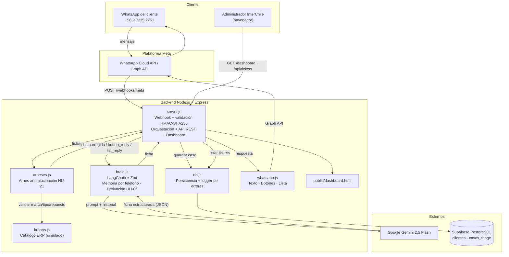

# Arquitectura de Software v2 (Hito 2 / Sprint 2) — Bot Triage InterChile

Esta versión refleja la **implementación real** del Sprint 2. Reemplaza a la vista conceptual del Hito 1 (`ARQUITECTURA_V1.md`, que hablaba de RAG y de WhatsApp/Telegram genérico).

## 1. Diagrama de componentes (coincide 1:1 con `src/`)

## 2. Responsabilidades por componente

| Componente | Archivo | Responsabilidad | HU |
|---|---|---|---|
| Entrada y orquestación | `src/server.js` | Verifica webhook, valida firma HMAC, extrae texto/clic, coordina el pipeline, expone `/api/tickets` y `/dashboard`, manejador global de errores | HU-16, HU-20, HU-14 |
| Motor IA | `src/brain.js` | Prompt de sistema, salida estructurada con Zod, memoria por teléfono (10 msgs, expira 60 min), derivación a humano y silencio posterior, timeout 8 s y fallback | HU-02, HU-06, HU-16 |
| Arnés de IA | `src/arneses.js` | Intercepta la ficha antes de guardar/responder; reemplaza datos inventados por `[dato por confirmar]`; audita en `logs/alucinaciones.log`; no muta la ficha original | HU-21 |
| Catálogo ERP | `src/kronos.js` | Marcas, tipos de equipo y repuestos válidos (simulado; interfaz aislada para cambiar por API real) | HU-18 |
| Persistencia | `src/db.js` | Transacción cliente + caso, `ROLLBACK` ante error, log en `logs/error.log`, nunca lanza al flujo | HU-16 |
| Salida | `src/whatsapp.js` | Texto, botones (≤3) o lista (4–10), timeout 8 s, fallback a texto numerado | HU-20 |
| Vista admin | `public/dashboard.html` | KPIs, filtros, alerta "Requiere Humano" | HU-14 |

## 3. Decisiones técnicas y su justificación

| Decisión | Alternativa descartada | Justificación |
|---|---|---|
| Salida estructurada con **Zod** (`withStructuredOutput`) | Parsear texto libre / JSON a mano | Contrato tipado y verificable; evita errores de formato al persistir |
| **Arnés separado** de la IA | Confiar en el prompt para no alucinar | La validación determinista contra catálogo es auditable y testeable; el prompt no garantiza nada |
| **Lista interactiva** cuando hay >3 opciones | Recortar a 3 botones | Meta limita los botones a 3; la lista admite hasta 10 sin perder "Arriendo" |
| Memoria **en RAM** con expiración | Persistir historial en BD | Simplicidad y latencia para el prototipo; el ticket sí persiste en BD (límite conocido → Hito 3) |
| **HMAC-SHA256** sobre el cuerpo crudo | Confiar en el endpoint | Evita que terceros inyecten mensajes falsos |
| Responder **siempre 200** a Meta en errores internos | Propagar 500 | Evita reintentos en cascada de Meta; el error queda en log |
| Temperatura 0 en Gemini | Temperatura alta | Triage requiere respuestas reproducibles |

## 4. Atributos de calidad

| Atributo | Cómo se materializa | Verificación |
|---|---|---|
| **Seguridad** | HMAC-SHA256, RLS en Supabase, secretos en `.env` | `test/integracion.test.js` (firma ausente/inválida) |
| **Disponibilidad / resiliencia** | Timeouts de 8 s, fallbacks, rollback, handler global | `test/interchile.test.js`, evidencias EV-07/EV-11 |
| **Usabilidad** | Botones y lista, respuestas breves y empáticas | Evidencia EV-09 |
| **Mantenibilidad** | Módulos de responsabilidad única, 17 + tests de integración | `npm test` |
| **Precisión** | Arnés contra catálogo | `test/arneses.test.js` |

## 5. Limitaciones conocidas (se declaran explícitamente)
- Catálogo Kronos simulado (no API real del ERP).
- Memoria conversacional y lista de derivados en RAM (se pierden al reiniciar).
- URL pública mediante túnel Cloudflare efímero (producción requiere hosting con URL fija).
