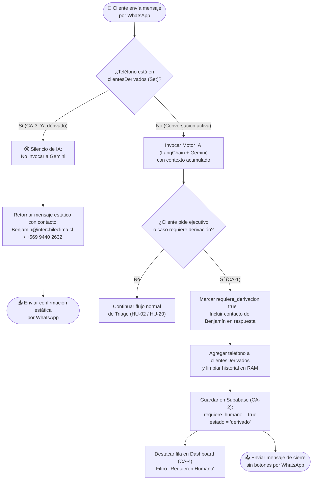

# Diagrama de Flujo de Negocio — HU-06: Derivación a Humano (Handoff Comercial)

**Proyecto:** Bot Triage Comercial InterChile
**Sprint:** Sprint 2
**Historia de Usuario:** HU-06
**Fecha:** Octubre 2026

---

## Historia de Usuario

> **Como** cliente corporativo o con una solicitud compleja en InterChile,
> **Quiero** ser derivado de inmediato a un ejecutivo humano cuando lo solicite o mi caso lo amerite,
> **Para** recibir atención directa sin que el bot me siga haciendo preguntas automáticas.

---

## Criterios de Aceptación (CA) cubiertos por este diagrama

| CA | Descripción |
|---|---|
| CA-1 | Detección explícita de solicitud de humano o caso complejo, entregando datos de contacto (Benjamín) |
| CA-2 | Actualización de estado en Supabase (`requiere_humano = true`, `estado = 'derivado'`) |
| CA-3 | Silencio post-derivación: futuros mensajes del mismo número reciben respuesta estática sin invocar a la IA |
| CA-4 | El ticket derivado se visualiza destacado en la pestaña "Requieren Humano" del Dashboard |

---

## Diagrama de Flujo de Negocio

---

## Asociación con Código Fuente

| Elemento del diagrama | Archivo | Función / Variable |
|---|---|---|
| Registro de silencio post-escalada | `src/brain.js` | `const clientesDerivados = new Set()` |
| Mensaje estático post-derivación | `src/brain.js` | `MENSAJE_ESTATICO_DERIVADO` |
| Detección semántica de derivación | `src/brain.js` | Campo Zod `requiere_derivacion: z.boolean()` |
| Persistencia de estado derivado | `src/db.js` | `estadoCaso = ficha.requiere_derivacion ? 'derivado' : 'en_proceso'` |
| Envío de cierre sin botones | `src/server.js` | `if (fichaEstructurada.requiere_derivacion)` |
