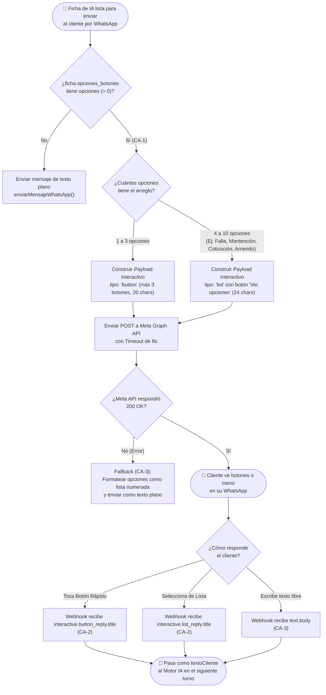

# Diagrama de Flujo de Negocio — HU-20: Botones y Listas Interactivas en WhatsApp

**Proyecto:** Bot Triage Comercial InterChile
**Sprint:** Sprint 2
**Historia de Usuario:** HU-20
**Fecha:** Octubre 2026

---

## Historia de Usuario

> **Como** cliente que se comunica por WhatsApp con InterChile,
> **Quiero** poder seleccionar el motivo de mi consulta tocando botones o un menú interactivo en vez de escribir todo a mano,
> **Para** agilizar mi atención y evitar errores al describir lo que necesito (Falla Técnica, Mantención, Cotización o Arriendo).

---

## Criterios de Aceptación (CA) cubiertos por este diagrama

| CA | Descripción |
|---|---|
| CA-1 | Envío de opciones interactivas cuando la IA sugiere `opciones_botones` (botones rápidos si son ≤3 opciones, o Menú de Lista si son 4 a 10 opciones como al incluir "Arriendo") |
| CA-2 | Procesamiento transparente cuando el cliente presiona un botón (`button_reply`) o elige un ítem de lista (`list_reply`) |
| CA-3 | Fallback a texto libre si el cliente prefiere escribir en lugar de usar los botones, o si la API interactiva falla |

---

## Diagrama de Flujo de Negocio

---

## Asociación con Código Fuente

| Elemento del diagrama | Archivo | Función / Bloque |
|---|---|---|
| Generación de opciones | `src/brain.js` | Campo Zod `opciones_botones: z.array(z.string().max(24)).max(10)` |
| Decisión Botones vs Lista | `src/whatsapp.js` | `enviarMensajeConBotones()` (`opciones.length <= 3`) |
| Recepción `button_reply` y `list_reply` | `src/server.js` | Bloque `if (waMessage.type === 'interactive')` |
| Fallback a lista numerada | `src/whatsapp.js` | Catch / `!response.ok` en `enviarMensajeConBotones()` |
