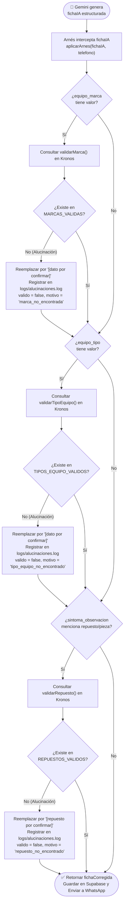

# Diagrama de Flujo de Negocio — HU-18 / HU-21: Arneses de IA y Validación contra Kronos

**Proyecto:** Bot Triage Comercial InterChile
**Sprint:** Sprint 2
**Historia de Usuario:** HU-18 / HU-21
**Fecha:** Octubre 2026

---

## Historia de Usuario

> **Como** administrador de operaciones de InterChile,
> **Quiero** que todas las fichas generadas por la IA sean validadas contra el catálogo del ERP Kronos antes de guardarse o enviarse al cliente,
> **Para** evitar alucinaciones de marcas, tipos de equipo o repuestos inexistentes.

---

## Criterios de Aceptación (CA) cubiertos por este diagrama

| CA | Descripción |
|---|---|
| CA-1 | El arnés intercepta la ficha de Gemini ANTES de guardar en Supabase o responder por WhatsApp |
| CA-2 | Si detecta una marca, tipo de equipo o repuesto que no existe en Kronos, lo reemplaza por `[dato por confirmar]` o `[repuesto por confirmar]` sin mutar el objeto original |
| CA-3 | Registra la alucinación en `logs/alucinaciones.log` y retorna `{ valido, motivo, fichaCorregida }` |
| CA-4 | Si la consulta a Kronos falla o supera el tiempo de espera, aplica fallback seguro sin interrumpir la atención |

---

## Diagrama de Flujo de Negocio

---

## Asociación con Código Fuente

| Elemento del diagrama | Archivo | Función |
|---|---|---|
| Intercepción en pipeline | `src/server.js` | `aplicarArnes(fichaIA, telefonoCliente)` |
| Validador de ficha | `src/arneses.js` | `validarFichaConKronos(ficha)` |
| Auditoría de alucinaciones | `src/arneses.js` | `logAlucinacion()` → `logs/alucinaciones.log` |
| Catálogo ERP Kronos | `src/kronos.js` | `validarMarca()`, `validarTipoEquipo()`, `validarRepuesto()` |
| Pruebas unitarias Jest | `test/arneses.test.js` | 13 tests unitarios verificando CA-1, CA-2 y CA-3 |
