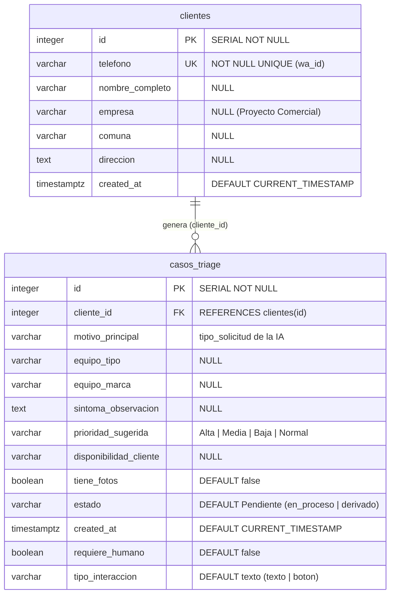

# Diseño de Datos — Sprint 2

**Fuente:** contrastado directamente contra la base de datos viva en Supabase (`public.clientes` y `public.casos_triage`) y las consultas reales de [`src/db.js`](file:///c:/Users/count/Documents/New%20project/bot-verificador-x-prototipo/src/db.js) (`guardarCasoTriage`, `getTicketsDashboard`).

> ✅ **Esquema consolidado y verificado (19-10-2026):** la migración inicial `supabase/migrations/20260824000000_initial_schema.sql` (Hito 1) fue reemplazada funcionalmente durante el Sprint 1–2 por el esquema relacional con claves `SERIAL`/`INTEGER`. Se ha consolidado el esquema vivo exacto (incluyendo columnas `requiere_humano`, `tipo_interaccion` e índices B-Tree para el Dashboard) en [`supabase/migrations/20261019000000_sprint2_consolidated_schema.sql`](file:///c:/Users/count/Documents/New%20project/bot-verificador-x-prototipo/supabase/migrations/20261019000000_sprint2_consolidated_schema.sql). Estado actual en Supabase: **4 clientes registrados y 69 casos de triage persistidos**.

## 1. Modelo entidad–relación (verificado en Supabase)

### Índices y Restricciones activas en PostgreSQL (`public`)
- `clientes_pkey`: `PRIMARY KEY (id)`
- `clientes_telefono_key`: `UNIQUE (telefono)`
- `casos_triage_pkey`: `PRIMARY KEY (id)`
- `casos_triage_cliente_id_fkey`: `FOREIGN KEY (cliente_id) REFERENCES clientes(id)`
- `idx_casos_triage_cliente_id`: `INDEX USING btree (cliente_id)` (optimiza el `INNER JOIN` del Dashboard)
- `idx_casos_triage_created_at_desc`: `INDEX USING btree (created_at DESC)` (optimiza `ORDER BY t.created_at DESC LIMIT $1`)

## 2. Reglas de negocio sobre los datos

| Regla | Dónde se implementa |
|---|---|
| Un teléfono = un cliente (se busca por `telefono`, se crea si no existe) | `db.js` → `SELECT … WHERE telefono` / `INSERT clientes` |
| El nombre del cliente solo se completa si estaba vacío (no se sobrescribe) | `db.js` → `UPDATE … WHERE nombre_completo IS NULL OR = ''` |
| Cliente y caso se guardan en **una transacción** (`BEGIN/COMMIT/ROLLBACK`) | `db.js` |
| `estado = 'derivado'` y `requiere_humano = true` cuando la IA deriva | `db.js` (`estadoCaso`) |
| La ficha se valida con Zod **antes** de llegar a la BD y el arnés corrige datos inventados | `brain.js`, `arneses.js` |
| Un fallo de BD no interrumpe la atención: se registra en `logs/error.log` | `db.js` → `logError` |

## 3. Procesos y plataformas

| Proceso | Plataforma | Decisión y justificación |
|---|---|---|
| Canal de conversación | WhatsApp Cloud API (Meta) | Canal que ya usa el cliente; sin app nueva que instalar |
| Extracción semántica | Gemini 2.5 Flash vía LangChain | Velocidad y costo; salida estructurada con Zod |
| Persistencia | Supabase (PostgreSQL gestionado) | SQL relacional, transacciones, RLS |
| Validación de dominio | Catálogo Kronos (simulado) | Aísla la validación; interfaz lista para API real |
| Exposición | Express + túnel Cloudflare (desarrollo) | Webhook público sin infraestructura propia |
