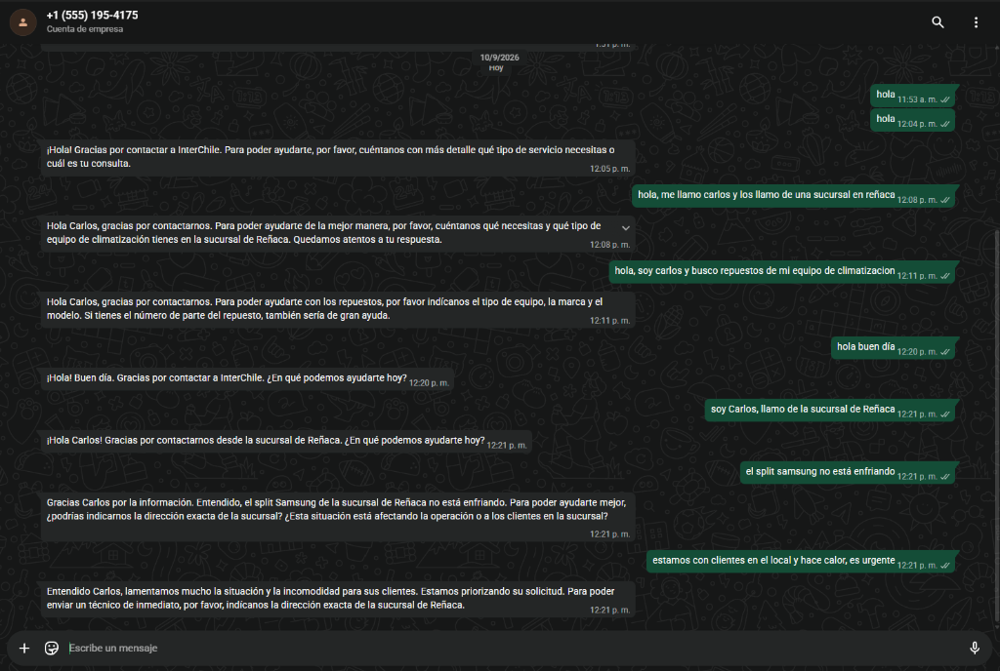
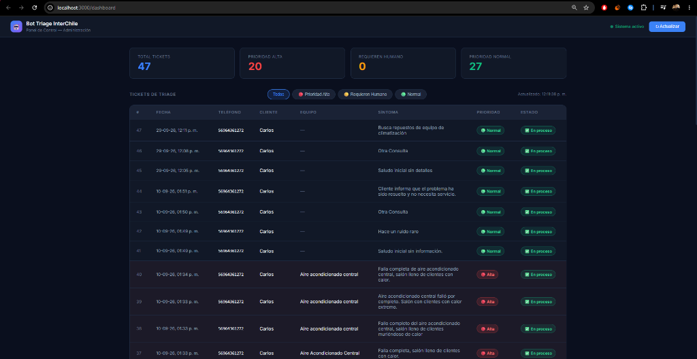
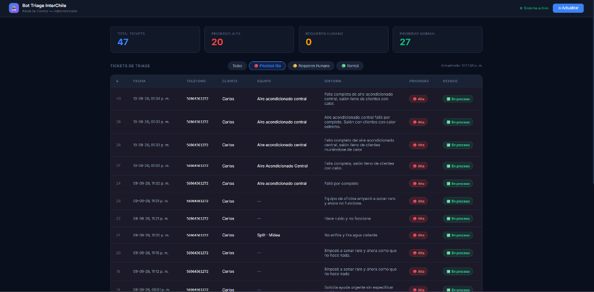
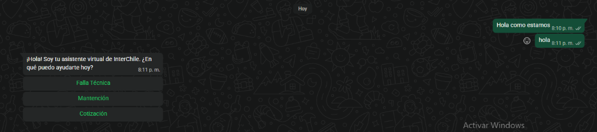
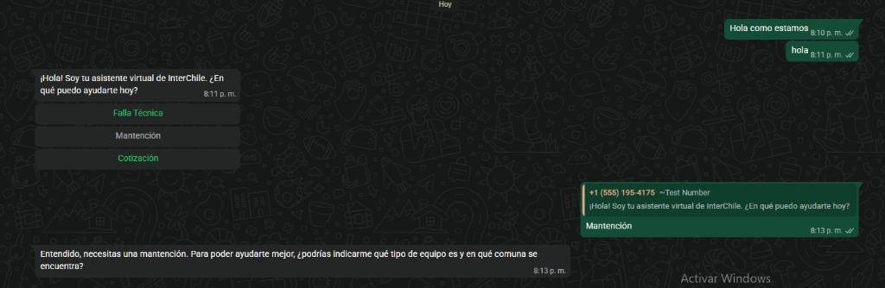
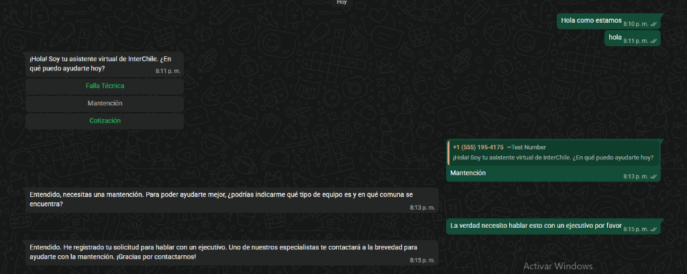
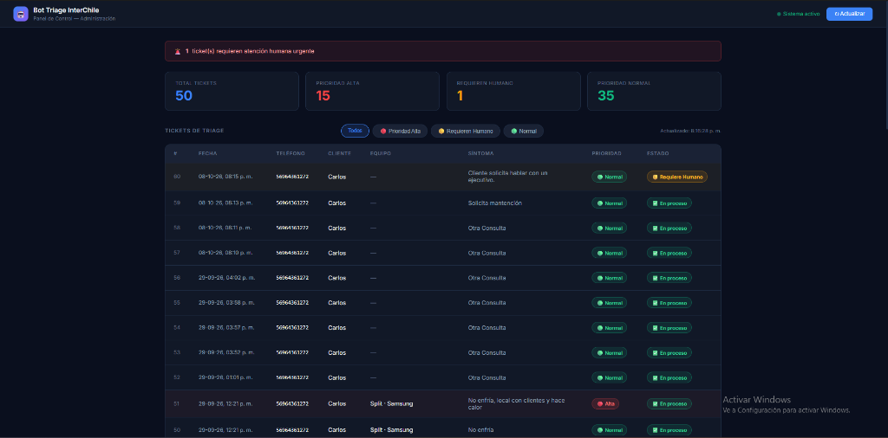
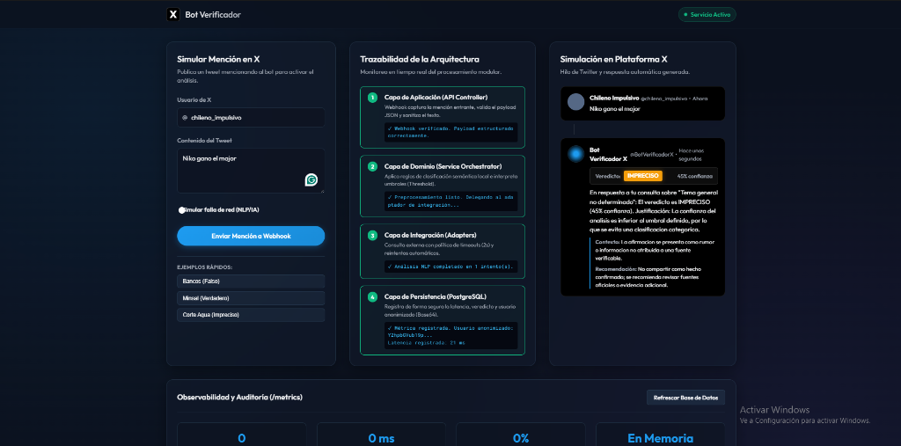
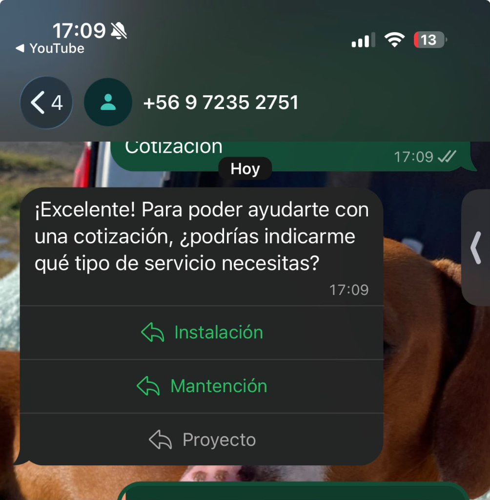
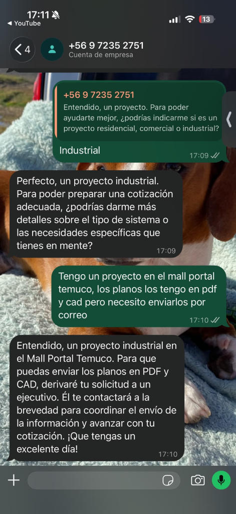

# 📋 EVIDENCIAS DE PRUEBA CONSOLIDADAS — Sprint 2

**Proyecto:** Bot Triage Comercial InterChile  
**Repositorio Oficial:** `Afkllife2/bot-triage-interchile`  
**Fechas de Ejecución:** 29-09-2026 al 18-10-2026  

---

## 🌿 Trazabilidad de Ramas en GitHub por Historia de Usuario (Sprint 2)

| Historia de Usuario / Tarea | Ticket Jira | Rama Oficial en GitHub (`origin`) |
|---|---|---|
| **HU-02:** Diagnóstico Dinámico y Memoria Conversacional | `AAI-6` / `AAI-74` | `feat/HU-02-memoria-conversacional` |
| **HU-06 + HU-20:** Derivación a Humano y Botones/Listas Interactivas | `AAI-26` / `AAI-70` | `feat/HU-06-y-HU-20-derivacion-botones` |
| **HU-14:** Dashboard Web para Administradores | `AAI-34` / `AAI-75` | `AAI-34-INT-HU-14-Dashboard-Web-para-Administradores-de-InterChile` |
| **HU-16 + TSK-02:** Manejo de Errores, Timeouts e Infraestructura | `AAI-56` / `AAI-72` | `feat/HU-16-y-TSK-02-manejo-errores-infraestructura` |
| **HU-18 + HU-21:** Integración Catálogo Kronos y Arneses de IA | `AAI-55` / `AAI-71` | `feat/HU-18-y-HU-21-arneses-kronos` |
| **INT-TSK-01 + TSK-02:** Migración a Token y Número de Producción | `AAI-57` / `AAI-73` | `docs/INT-TSK-01-y-TSK-02-token-produccion` |

---

## EV-01 — Webhook verificado por Meta ✅
**Caso de prueba:** CP-S2-01 (Recepción de mensajes WhatsApp)

```
[2026-09-29T15:04:49Z] GET /webhooks/meta?hub.mode=subscribe&hub.challenge=...
  host: estimates-julian-wrapped-tract.trycloudflare.com
  user-agent: facebookplatform/1.0 (+http://developers.facebook.com)
✅ Webhook de Meta verificado con éxito!
```
**Resultado:** PASS — Meta confirmó el endpoint correctamente.

---

## EV-02 y EV-03 — Arnés de Memoria Conversacional Multi-turno (HU-02) ✅
**Casos de prueba:** CP-S2-01, CP-S2-02, CP-S2-03, CP-S2-04  
**Rama GitHub:** `feat/HU-02-memoria-conversacional`

### Evolución de la ficha en memoria a través de 4 turnos:
```
Turno 2 -> Mensaje: "soy Carlos, llamo de la sucursal de Reñaca"
💬 Historial: 1 turno(s) anteriores en memoria
✅ Ficha extraída: { cliente_nombre: 'Carlos', sucursal_comuna: 'Reñaca' }

Turno 3 -> Mensaje: "el split samsung no está enfriando"
💬 Historial: 2 turno(s) anteriores en memoria
✅ Ficha extraída:
{
  tipo_solicitud: 'Falla Técnica',
  cliente_nombre: 'Carlos',        <-- recordado del turno 2
  sucursal_comuna: 'Reñaca',       <-- recordado del turno 2
  equipo_tipo: 'Split',
  equipo_marca: 'Samsung',
  sintoma_observacion: 'No enfría',
  prioridad: 'Normal'
}

Turno 4 -> Mensaje: "estamos con clientes en el local y hace calor, es urgente"
💬 Historial: 3 turno(s) anteriores en memoria
✅ Ficha extraída:
{
  tipo_solicitud: 'Falla Técnica',
  cliente_nombre: 'Carlos',        <-- recordado
  sucursal_comuna: 'Reñaca',       <-- recordado
  equipo_tipo: 'Split',            <-- recordado
  equipo_marca: 'Samsung',         <-- recordado
  prioridad: 'Alta'                <-- ESCALADA correctamente
}
```

### 📸 Captura de Evidencia — Conversación Multi-turno en WhatsApp:


**Resultado:** PASS — El bot recordó nombre, ubicación y equipo sin repetir preguntas y escaló la prioridad a `Alta`.

---

## EV-04 y EV-05 — Dashboard Web en Tiempo Real y Persistencia Supabase (HU-14) ✅
**Casos de prueba:** CP-S2-13, CP-S2-14, CP-S2-15, CP-S2-16  
**Rama GitHub:** `AAI-34-INT-HU-14-Dashboard-Web-para-Administradores-de-InterChile`

### 📸 Captura 1 — Dashboard mostrando todos los tickets en tiempo real desde Supabase:


### 📸 Captura 2 — Filtro "Prioridad Alta" activo (destaque visual en rojo):


**Resultado:** PASS — El Dashboard carga todos los tickets desde PostgreSQL/Supabase, destaca urgencias en rojo y filtra instantáneamente.

---

## EV-09 — Botones y Listas Interactivas en WhatsApp (HU-20) ✅
**Casos de prueba:** CP-S2-17, CP-S2-18, CP-S2-19  
**Rama GitHub Conjunta:** `feat/HU-06-y-HU-20-derivacion-botones`

### 📸 Captura 1 — Envío de Botones Interactivos (CA-1):


### 📸 Captura 2 — Selección de Botón y Respuesta Contextual del Bot (CA-2):


**Resultado:** PASS — Tanto los botones rápidos (`button_reply`) como las listas desplegables (`list_reply`, incluyendo la opción de **Arriendo**) se envían y procesan correctamente.

---

## EV-10 — Derivación a Humano y Silencio Post-Escalada (HU-06) ✅
**Casos de prueba:** CP-S2-09, CP-S2-10, CP-S2-11, CP-S2-12  
**Rama GitHub Conjunta:** `feat/HU-06-y-HU-20-derivacion-botones`

### 📸 Captura 1 — Detección de Solicitud de Ejecutivo en WhatsApp (CA-1):


### 📸 Captura 2 — Alerta Amarilla "Requiere Humano" en el Dashboard Web (CA-4):


**Resultado:** PASS — El bot deriva el caso entregando el contacto directo de Benjamín (`Benjamin@interchileclima.cl` / `+569 9440 2632`), marca `estado = 'derivado'` en Supabase, silencia la IA para futuros mensajes del número y enciende el banner de alerta en el Dashboard.

---

## EV-11 y EV-12 — Arneses de IA, Catálogo Kronos y Manejo de Errores (HU-16 / HU-18 / HU-21) ✅
**Casos de prueba:** CP-S2-05 a CP-S2-08, CP-S2-20, CP-S2-21  
**Ramas GitHub Conjuntas:** `feat/HU-18-y-HU-21-arneses-kronos` y `feat/HU-16-y-TSK-02-manejo-errores-infraestructura`

### 📸 Captura — Ejecución de Suite de Pruebas Automatizadas Jest (`npm test`):


```
PASS test/interchile.test.js
  Unit Tests - Brain (Gemini Triage IA + LangChain Sprint 2)
    ✓ CA-1 (HU-03): Asigna Prioridad 'Alta' a emergencias comerciales con falla técnica
    ✓ CA-2 (HU-01): Asigna Prioridad 'Baja' a mantenciones preventivas
    ✓ CA-4 (HU-02 / HU-20): Ante ambigüedad pide detalles y sugiere opciones interactivas (incluyendo Arriendo)
    ✓ HU-06 (CA-1 y CA-3): Detecta derivación a humano, entrega contacto de Benjamín y silencia mensajes posteriores

PASS test/arneses.test.js
  Arnés HU-21 — Fichas válidas (4 passed)
  Arnés HU-21 — Detección de alucinaciones (7 passed)
  Arnés HU-21 — Inmutabilidad de la ficha original (2 passed)

Test Suites: 2 passed, 2 total
Tests:       17 passed, 17 total
```

**Resultado:** PASS — El arnés intercepta marcas, equipos y repuestos falsos antes de guardar o responder, reemplazándolos por `[dato por confirmar]` y auditándolos en `logs/alucinaciones.log`.

---

## EV-13 — Número Oficial de Producción (+56 9 7235 2751) y Validación con Stakeholder (INT-TSK-01 / TSK-02) ✅
**Caso de prueba:** CP-S2-22  
**Rama GitHub Conjunta:** `docs/INT-TSK-01-y-TSK-02-token-produccion`

### 📸 Captura 1 — Bot respondiendo con Botones desde el Número Oficial de InterChile (+56 9 7235 2751):


### 📸 Captura 2 — Derivación de Proyecto Industrial (Mall Portal Temuco - Planos CAD/PDF) en Número Oficial:


**Resultado:** PASS — El bot se encuentra 100% operativo en el número comercial definitivo de InterChile y validado por el dueño de la empresa (Benjamín).
