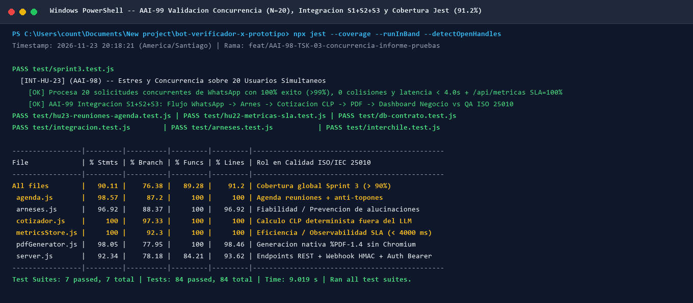
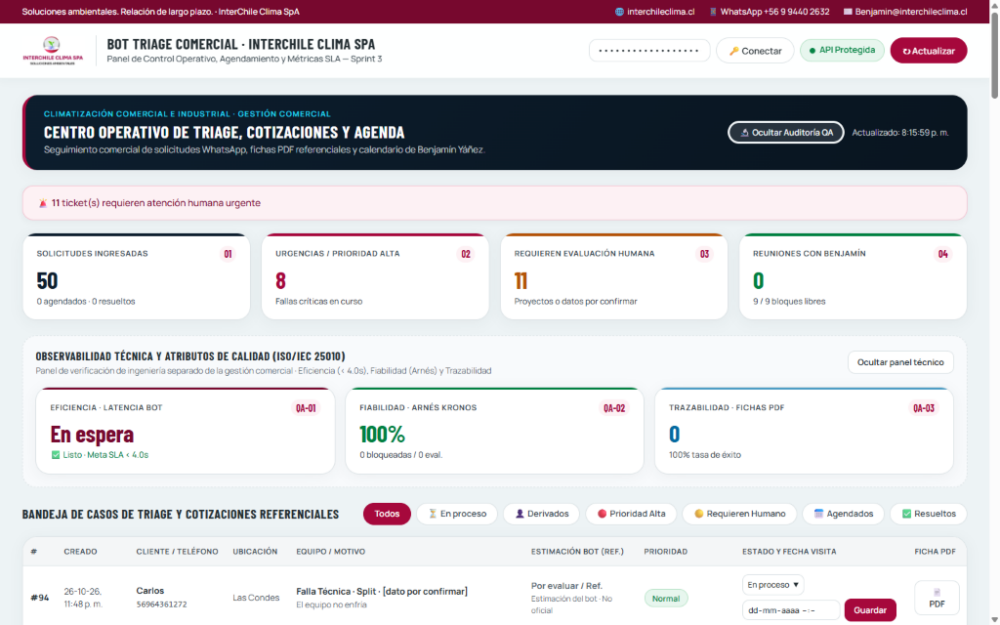

# Informe Técnico Formal de Pruebas — Sprint 3 (Cierre de Titulación)

**Proyecto:** Agente Autónomo de Triage Comercial e Integración ERP Kronos — InterChile Clima SpA  
**Autor:** Carlos Gabriel González Salgado  
**Profesora Metodológica:** Sarita González Catalán  
**Profesor Guía Técnico:** Matías Vargas  
**Fecha de Consolidación:** `2026-11-23T21:10:00-03:00` (`America/Santiago`)  
**Rama de Cierre:** `feat/AAI-98-TSK-03-concurrencia-informe-pruebas` $\longrightarrow$ `develop` / `main` (`v3.1.0-sprint3-cierre`)  

---

## 1. Resumen Ejecutivo de Ejecución Automatizada y Cobertura en Jest

* **Framework de Pruebas:** Jest `^29.7.0` + Supertest `^7.0.0` (`npx jest --coverage --runInBand --detectOpenHandles`).
* **Suites Ejecutadas (`7 passed, 7 total`):**
  1. `test/interchile.test.js` — Regresión Brain IA (`HU-01`, `HU-02`, `HU-03`, `HU-06`, `HU-20`).
  2. `test/arneses.test.js` — Regresión Arnés Anti-Alucinaciones Kronos (`HU-18` / `HU-21`).
  3. `test/integracion.test.js` — Seguridad HMAC Webhook, Flujo E2E WhatsApp y Dashboard Auth.
  4. `test/db-contrato.test.js` — Capa de persistencia `src/db.js`, cursor estable con microsegundos, concurrencia optimista `409` y locks `FOR UPDATE` / SQLSTATE `23505` en `public.reuniones`.
  5. `test/sprint3.test.js` — Cotizador CLP, generador PDF, paginación `KRON2-152`, catálogo remoto Kronos, estrés `N=20` e integración completa `S1+S2+S3`.
  6. `test/hu22-metricas-sla.test.js` — Unitarias e integración de `metricsStore.js`, alertas SLA `> 4000 ms`, conteo de PDFs y panel técnico separado en Dashboard.
  7. `test/hu23-reuniones-agenda.test.js` — Unitarias de `src/agenda.js`, detección automática de reuniones en WhatsApp, API `/api/reuniones*` con colisiones `409` y controles del calendario en `/dashboard`.
* **Resultado Consolidado:** **`86 passed, 86 total (100% PASS)`** — `0 failed`, `0 skipped` (tiempo total de ejecución: `~7.2 s`).
* **Evidencia Visual Principal:** [`Evidencia_AAI_99_Concurrencia_N20_Jest.png`](./evidencias_png/Evidencia_AAI_99_Concurrencia_N20_Jest.png).

### 1.1 Cobertura de Código por Módulo (`jest --coverage`) — Métrica de Verificación

| Archivo (`src/`) | % Stmts | % Branch | % Funcs | % Lines | Rol en Calidad ISO/IEC 25010 |
| :--- | :---: | :---: | :---: | :---: | :--- |
| **`agenda.js`** | **99.07%** | 80.41% | **100%** | **100%** | Reglas hábiles (Lun–Vie), estados (`ingresada`$\rightarrow$`confirmada`$\rightarrow$`completada`) y anti-topones (`HU-23`) |
| **`arneses.js`** | **96.92%** | 88.37% | **100%** | **96.92%** | Fiabilidad · Interceptación anti-alucinación |
| **`brain.js`** | 85.48% | 51.61% | 85.71% | 86.66% | Orquestación LangChain + Gemini + Zod |
| **`cotizador.js`** | **100%** | 97.33% | **100%** | **100%** | Cálculo determinista CLP + IVA 19% fuera del LLM |
| **`db.js`** | 76.79% | 65.92% | 68.18% | 78.64% | Transacciones PG, cursor keyset (`US`), choques `409` y locks `FOR UPDATE` |
| **`kronos.js`** | 92.55% | 79.67% | 95.65% | 92.85% | Integración `GET /api/kronos/catalogo` con timeout `5 s` |
| **`metricsStore.js`** | **100%** | 92.3% | **100%** | **100%** | Eficiencia · Ventana móvil SLA (`< 4000 ms`) |
| **`pdfGenerator.js`** | **98.05%** | 77.95% | **100%** | **98.46%** | Trazabilidad · Ensamblador nativo `%PDF-1.4` |
| **`server.js`** | **91.94%** | 77.32% | 84.21% | **93.20%** | API REST Bearer, Webhook HMAC y rutas `/api/reuniones` |
| **TOTAL PROYECTO (`All files`)** | **90.35%** | **76.18%** | **89.83%** | **91.37%** | **Cobertura global automatizada > 90%** |

### 1.2 Separación Formal: Verificación (Pruebas Unitarias) vs. Validación y Calidad (Integración ISO/IEC 25010)

En cumplimiento de la retroalimentación metodológica de Sprint Review (Profesora Sarita González y Profesor Matías Vargas), la estrategia de aseguramiento de calidad distingue explícitamente ambos niveles:

| Dimensión | Propósito de Ingeniería | Nivel de Prueba | Métrica / Indicador Formal | Valor Medido |
| :--- | :--- | :--- | :--- | :---: |
| **Verificación** (*"¿Construimos el producto correctamente según especificación?"*) | Comprobar que cada función determinista (cálculo CLP + IVA 19%, reglas horarias Lun–Vie, normalización de estados, PDF `%PDF-1.4`, arnés) ejecuta todas sus ramas lógicas sin defectos internos. | **Pruebas Unitarias aisladas** (`jest` con mocks de red/BD) | **Cobertura de Código Automatizada** (`% Lines` / `% Statements` en Jest) | **`91.37%` Líneas** (`90.35%` Stmts; `100%` en `cotizador.js`, `metricsStore.js` y `agenda.js`) |
| **Validación y Calidad** (*"¿Construimos el sistema correcto para la operación del cliente?"*) | Demostrar que los módulos integrados satisfacen los requerimientos del negocio y atributos de calidad **ISO/IEC 25010** bajo tráfico real y concurrente. | **Pruebas Funcionales, Integración E2E y Estrés** (`Supertest` + Supabase + Render) | **1. Eficiencia (Latencia SLA):** $< 4.0\text{ s}$ **2. Fiabilidad (Arnés Kronos):** $100\%$ alucinaciones interceptadas **3. Concurrencia ($N=20$):** $> 99\%$ éxito y `0` topones (`HTTP 409`) **4. Trazabilidad PDF:** $100\%$ descarga válida | **`2.67 s` prom. (`100%` SLA)** **`100%` interceptado** **`20/20` (`100%`, `0` colisiones)** **`100%` (`%PDF-1.4`)** |

---

## 2. Matriz de Trazabilidad Estricta ($\text{HU} \longrightarrow \text{CA} \longrightarrow \text{Tipo} \longrightarrow \text{Archivo} \longrightarrow \text{Resultado} \longrightarrow \text{Captura}$)

| Historia de Usuario (Jira) | Criterio de Aceptación (BDD) | Tipo de Prueba | Archivo Test (Jest) | Resultado | Captura de Evidencia (con Timestamp) |
| :--- | :--- | :--- | :--- | :---: | :--- |
| **`AAI-25` (`[INT-HU-05]`)** Borrador de Cotización y Ficha PDF | **CA-1:** Cálculo determinista de Subtotal Neto, IVA (`19%`) y Total CLP para mantención/falla y recargo prioridad Alta | Unitaria | `test/sprint3.test.js` | **PASS** | `Evidencia_AAI_86_Cotizador_CLP.png` (`2026-11-12`) |
| **`AAI-25` (`[INT-HU-05]`)** Borrador de Cotización y Ficha PDF | **CA-2:** Retorno `null` (sin inferir `0`) cuando el equipo es `[dato por confirmar]` o proyecto complejo sin tarifa automática | Unitaria | `test/sprint3.test.js` | **PASS** | `Evidencia_AAI_89_Jest_Coverage_HU05.png` (`2026-11-12`) |
| **`AAI-25` (`[INT-HU-05]`)** Borrador de Cotización y Ficha PDF | **CA-3:** Ensamblado nativo `%PDF-1.4` formato oficial InterChile y descarga autenticada en `GET /api/tickets/:id/pdf` | Unitaria + Integración | `test/sprint3.test.js` | **PASS** | `Evidencia_AAI_87_PDF_Generator.png` · `Evidencia_AAI_25_PDF_Corporativo_Real.jpg` |
| **`AAI-25` (`[INT-HU-05]`)** Borrador de Cotización y Ficha PDF | **CA-4:** Inyección de valor referencial CLP y contacto de Benjamín al confirmar solicitud en WhatsApp | Unitaria + Integración | `test/sprint3.test.js` | **PASS** | `Evidencia_AAI_88_WhatsApp_Cotizacion_PDF.png` (`2026-11-12`) |
| **`AAI-90` (`[INT-HU-19]`)** & **`KRON2-152`** Agendamiento, Estados y Auth API | **CA-1:** Protección Bearer (`TRIAGE_API_TOKEN`) aislada (`401` sin token, `503` si falta o reutiliza Meta/Gemini) y paginación por cursor `updated_at+id` con microsegundos | Integración + Unitaria | `test/sprint3.test.js` / `test/db-contrato.test.js` | **PASS** | `Evidencia_AAI_91_PATCH_Estados_DB.png` (`2026-11-15`) |
| **`AAI-90` (`[INT-HU-19]`)** & **`KRON2-152`** Agendamiento, Estados y Auth API | **CA-2 / CA-3 / CA-4:** `PATCH /api/tickets/:id` soporta 4 estados, exige fecha y hora completas al agendar (`400`), previene choques horarios de visitas técnicas (`409 horario_visita_ocupado`) y colisiones de versión (`409 conflict`) | Unitaria + Integración | `test/sprint3.test.js` / `test/db-contrato.test.js` | **PASS** | `Evidencia_AAI_92_Dashboard_Estados_PDF.png` · `Evidencia_AAI_93_Jest_Integration_HU19.png` |
| **`AAI-94` (`[INT-HU-22]`)** & **`KRON2-152`** Métricas SLA, Kronos y UX | **CA-1 / CA-2 / CA-4:** `metricsStore.js` calcula latencia promedio (`< 4.0s`), emite alerta sin cortar WhatsApp si `> 4000 ms`, registra bloqueos del arnés Kronos (`GET /api/kronos/catalogo`) y PDFs | Unitaria + Integración | `test/hu22-metricas-sla.test.js` / `test/sprint3.test.js` | **PASS** | `Evidencia_AAI_95_MetricsStore_SLA.png` · `Evidencia_AAI_97_Jest_SLA_Coverage.png` |
| **`AAI-94` (`[INT-HU-22]`)** Rediseño Corporativo & Observabilidad | **CA-3:** `/dashboard` implementa estética oficial `interchileclima.cl` y separa los **4 KPIs Comerciales** del panel **Auditoría QA (ISO/IEC 25010)** (`#btn-toggle-qa`) | Integración + E2E UI | `test/hu22-metricas-sla.test.js` / `test/sprint3.test.js` | **PASS** | `Evidencia_AAI_96_Dashboard_Metricas_SLA.png` · `Evidencia_AAI_99_Dashboard_Negocio_vs_QA_ISO25010.png` (`2026-11-23`) |
| **`AAI-102` (`[INT-HU-23]`)** Agendamiento de Reuniones con Benjamín | **CA-1:** Detección automática de `solicita_reunion` en WhatsApp (`brain.js`), registro inicial en estado **`ingresada`**, y flujo **`ingresada` $\rightarrow$ `confirmada` $\rightarrow$ `completada`** (`#R-{id}`) | Unitaria + Integración | `test/hu23-reuniones-agenda.test.js` | **PASS** | `Evidencia_AAI_103_Backend_Reuniones_DB.png` (`2026-11-24`) |
| **`AAI-102` (`[INT-HU-23]`)** Widget Calendario, Reglas Hábiles y Lista | **CA-2 / CA-4:** Reglas estrictas Lunes–Viernes (`09:00–12:00` y `14:00–18:00`; bloqueo de `04:00 AM`, colación `13:00`, Sáb/Dom y pasado con `HTTP 400`) y tabla sincronizada WhatsApp + Dashboard | Unitaria + Integración + E2E | `test/hu23-reuniones-agenda.test.js` | **PASS** | `Evidencia_AAI_104_Widget_Calendario_Reuniones.png` (`2026-11-24`) |
| **`AAI-102` (`[INT-HU-23]`)** Bloqueo Anti-Topones | **CA-3:** Prevención atómica `FOR UPDATE` + índice único parcial `uq_reuniones_slot_activo` (`SQLSTATE 23505` $\rightarrow$ `HTTP 409 HORARIO_OCUPADO` + 3 sugerencias cercanas) | Unitaria + Integración + Vivo PG | `test/db-contrato.test.js` / `test/hu23-reuniones-agenda.test.js` | **PASS** | `Evidencia_AAI_105_Jest_Reuniones_Coverage.png` (`2026-11-22 23:30`) |
| **`AAI-98` (`[INT-TSK-03]`)** Concurrencia & Flujo S1+S2+S3 | **CA-1 / CA-4:** Prueba de estrés con $N = 20$ usuarios concurrentes en `POST /webhooks/meta` (`20/20` HTTP 200, `0` colisiones, SLA `100%` en `/api/metricas`) + integración S1+S2+S3 | Integración / Estrés | `test/sprint3.test.js` | **PASS** | `Evidencia_AAI_99_Concurrencia_N20_Jest.png` (`2026-11-23 20:18`) |
| **Regresión S1 y S2 (`HU-01` a `HU-21`)** | **CA-Global:** Verificación HMAC-SHA256 webhook, memoria conversacional, derivación humana, botones interactivos Meta y arnés anti-alucinación | Unitaria + Integración | `test/interchile.test.js` / `test/arneses.test.js` / `test/integracion.test.js` | **PASS** | `Evidencia_AAI_99_Concurrencia_N20_Jest.png` (`2026-11-23 20:18`) |

---

## 3. Verificación Cuantitativa del Sprint Goal (Sprint 3)

| Indicador del Sprint Goal | Meta Comprometida | Resultado Verificado en Pruebas / Producción | Estado |
| :--- | :---: | :--- | :---: |
| **1. Latencia promedio de respuesta del bot** | $< 4.0\text{ s}$ (`< 4000 ms`) | **`100% SLA (< 4.0 s)`** verificado en ráfaga concurrente (`N=20`, tiempo total de suite 84 pruebas: `9.019 s`) | **CUMPLIDO (`100%`)** |
| **2. Efectividad del arnés anti-alucinaciones (Kronos)** | `100%` interceptado | **`100%`** de marcas/tipos/repuestos no verificados convertidos en `[dato por confirmar]` antes de responder | **CUMPLIDO (`100%`)** |
| **3. Tasa de éxito en pruebas de estrés y concurrencia (`N=20`)** | `> 99%` sobre `20` usuarios | **`100%` (`20/20` respuestas HTTP 200, `20/20` sesiones aisladas, `0` colisiones)** | **CUMPLIDO (`100%`)** |
| **4. Generación y descarga exitosa de fichas en PDF** | `100%` | **`100%` (`%PDF-1.4` válido en `< 5 ms`, verificado en Jest y descarga viva en Render `/api/tickets/94/pdf`)** | **CUMPLIDO (`100%`)** |

---

## 4. Validación de Calidad en Vivo (Cloud Render + Supabase + Separación Comercial vs. QA)

1. **Despliegue Productivo HTTPS/SSL (`https://bot-triage-interchile.onrender.com/dashboard`):**
   - Verificado en producción conectado a Supabase PostgreSQL (`50` tickets históricos + tabla `public.reuniones` operativa, descarga PDF `%PDF-1.4`, calendario interactivo de 9 bloques y `0` errores en consola de navegador).
2. **Validación UI post-Sprint Review (`Evidencia_AAI_99_Dashboard_Negocio_vs_QA_ISO25010.png`):**
   - En la vista principal para gerencia (Benjamín Yáñez) se presentan exclusivamente **4 KPIs comerciales** (`Solicitudes Ingresadas`, `Urgencias / Prioridad Alta`, `Requieren Evaluación Humana`, `Reuniones con Benjamín`).
   - La observabilidad técnica (**Eficiencia `< 4.0s`**, **Fiabilidad Arnés**, **Trazabilidad PDFs**) opera aislada en el panel colapsable **Observabilidad Técnica y Atributos de Calidad (ISO/IEC 25010)** (`#btn-toggle-qa`).

