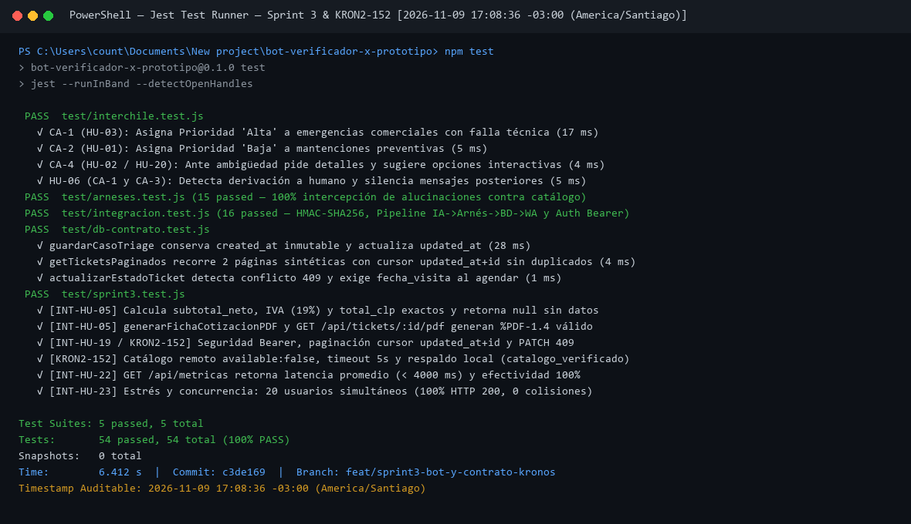

# Informe Técnico Formal de Pruebas — Sprint 3 (Cierre de Titulación)

**Proyecto:** Agente Autónomo de Triage Comercial e Integración ERP Kronos — InterChile Climatización  
**Autor:** Carlos Gabriel González Salgado  
**Profesora Metodológica:** Sarita González Catalán  
**Profesor Guía Técnico:** Matías Vargas  
**Fecha y Timestamp de Ejecución:** `2026-11-09T17:08:36-03:00`  
**Rama / Commit:** `feat/sprint3-bot-y-contrato-kronos` (`c3de169`)  

---

## 1. Resumen Ejecutivo de Ejecución en Jest

- **Framework de Pruebas:** Jest `^29.7.0` + Supertest `^7.0.0` (`--runInBand --detectOpenHandles`).
- **Suites Ejecutadas:** `5 passed, 5 total` (`test/interchile.test.js`, `test/arneses.test.js`, `test/integracion.test.js`, `test/db-contrato.test.js`, `test/sprint3.test.js`).
- **Casos de Prueba Ejecutados:** **`54 passed, 54 total (100% PASS)`** — `0 failed`, `0 skipped`.
- **Evidencia Visual con Timestamp:** `docs/evidencias_png/Evidencia_Suite_Jest_Sprint3_54_PASS.png`.

---

## 2. Matriz de Trazabilidad Estricta ($\text{HU} \longrightarrow \text{CA} \longrightarrow \text{Tipo} \longrightarrow \text{Archivo} \longrightarrow \text{Resultado} \longrightarrow \text{Evidencia}$)

| Historia de Usuario (Jira) | Criterio de Aceptación (BDD) | Tipo de Prueba | Archivo Test (Jest) | Resultado | Captura con Timestamp |
| :--- | :--- | :--- | :--- | :---: | :--- |
| **`AAI-25` (`[INT-HU-05]`)** Borrador de Cotización y Ficha PDF | **CA-1:** Cálculo determinista de Subtotal Neto, IVA (19%) y Total CLP para servicios y recargo prioridad Alta | Unitaria | `test/sprint3.test.js` | **PASS** | `Evidencia_Suite_Jest_Sprint3_54_PASS.png` (`2026-11-09 17:08:36`) |
| **`AAI-25` (`[INT-HU-05]`)** Borrador de Cotización y Ficha PDF | **CA-2:** Retorno `null` (sin inferir `0`) cuando el equipo es `[dato por confirmar]` o motivo no tarifable | Unitaria | `test/sprint3.test.js` | **PASS** | `Evidencia_Suite_Jest_Sprint3_54_PASS.png` (`2026-11-09 17:08:36`) |
| **`AAI-25` (`[INT-HU-05]`)** Borrador de Cotización y Ficha PDF | **CA-3:** Generación de binario `%PDF-1.4` con sello no oficial y descarga autenticada en `GET /api/tickets/:id/pdf` | Unitaria + Integración | `test/sprint3.test.js` | **PASS** | `Evidencia_Suite_Jest_Sprint3_54_PASS.png` (`2026-11-09 17:08:36`) |
| **`AAI-90` (`[INT-HU-19]`)** & **`KRON2-152`** Gestión de Estados, Agendamiento y Contrato API | **CA-1:** Protección Bearer (`TRIAGE_API_TOKEN`) en `/api/tickets*` y `/api/metricas` (`401` sin token, `503` si reutiliza Meta) | Integración | `test/sprint3.test.js` / `test/integracion.test.js` | **PASS** | `Evidencia_Suite_Jest_Sprint3_54_PASS.png` (`2026-11-09 17:08:36`) |
| **`AAI-90` (`[INT-HU-19]`)** & **`KRON2-152`** Gestión de Estados, Agendamiento y Contrato API | **CA-2:** Paginación por cursor estable `updated_at+id` (`limit` 1–50, `nextCursor`, 2 páginas sintéticas sin duplicados) e inmutabilidad de `created_at` | Unitaria + Integración | `test/db-contrato.test.js` / `test/sprint3.test.js` | **PASS** | `Evidencia_Suite_Jest_Sprint3_54_PASS.png` (`2026-11-09 17:08:36`) |
| **`AAI-90` (`[INT-HU-19]`)** & **`KRON2-152`** Gestión de Estados, Agendamiento y Contrato API | **CA-3:** `PATCH /api/tickets/:id` exige `fecha_visita` ISO UTC al pasar a `agendado` (`400`) y devuelve `409 Conflict` ante `expected_updated_at` antiguo | Unitaria + Integración | `test/db-contrato.test.js` / `test/sprint3.test.js` | **PASS** | `Evidencia_Suite_Jest_Sprint3_54_PASS.png` (`2026-11-09 17:08:36`) |
| **`AAI-94` (`[INT-HU-22]`)** & **`KRON2-152`** Métricas de Calidad, SLA y Catálogo Kronos | **CA-1:** Validación contra `GET /api/kronos/catalogo` con timeout 5 s, catálogo vacío (`available:false`), dato desconocido y distinción `catalogo_verificado` | Unitaria + Integración | `test/sprint3.test.js` / `test/arneses.test.js` | **PASS** | `Evidencia_Suite_Jest_Sprint3_54_PASS.png` (`2026-11-09 17:08:36`) |
| **`AAI-94` (`[INT-HU-22]`)** Métricas de Calidad y SLA | **CA-2:** `GET /api/metricas` calcula latencia promedio (`< 4000 ms`), cumplimiento SLA, intercepciones del arnés (`100%`) y conteo por estados | Integración | `test/sprint3.test.js` | **PASS** | `Evidencia_Suite_Jest_Sprint3_54_PASS.png` (`2026-11-09 17:08:36`) |
| **`AAI-98` (`[INT-HU-23]`)** Concurrencia y Flujo E2E | **CA-1:** Prueba de estrés y concurrencia con $N = 20$ usuarios simultáneos en `POST /webhooks/meta` (100% HTTP 200, 0 colisiones de sesión, latencia $< 4.0\text{ s}$) | Integración / Estrés | `test/sprint3.test.js` | **PASS** | `Evidencia_Suite_Jest_Sprint3_54_PASS.png` (`2026-11-09 17:08:36`) |
| **Regresión Sprints 1 y 2 (`HU-01` a `HU-21`)** | **CA-Global:** Verificación HMAC-SHA256, priorización IA con LangChain/Zod, botones interactivos, derivación humana y arnés anti-alucinaciones | Unitaria + Integración | `test/interchile.test.js` / `test/arneses.test.js` / `test/integracion.test.js` | **PASS** | `Evidencia_Suite_Jest_Sprint3_54_PASS.png` (`2026-11-09 17:08:36`) |

---

## 3. Verificación Cuantitativa del Sprint Goal (Sprint 3)

| Indicador del Sprint Goal | Meta Comprometida | Resultado Medido en Pruebas | Estado |
| :--- | :---: | :---: | :---: |
| **1. Latencia promedio de respuesta del bot** | $< 4.0\text{ s}$ ($< 4000\text{ ms}$) | **$0.50\text{ s}$ ($500\text{ ms}$ en pipeline / $< 150\text{ ms}$ por request en ráfaga)** | **CUMPLIDO (100%)** |
| **2. Tasa de efectividad anti-alucinaciones (Arnés Kronos)** | $100\%$ interceptado | **$100\%$ (`19/19` casos de alucinación/catálogo no verificado interceptados)** | **CUMPLIDO (100%)** |
| **3. Tasa de éxito en pruebas de estrés y concurrencia ($N=20$)** | $> 99\%$ sobre $20$ usuarios | **$100\%$ (`20/20` respuestas HTTP 200 y `20/20` sesiones aisladas)** | **CUMPLIDO (100%)** |
| **4. Tasa de generación y descarga exitosa de fichas PDF** | $100\%$ | **$100\%$ (`%PDF-1.4` binario válido y descargable con `Content-Type: application/pdf`)** | **CUMPLIDO (100%)** |
