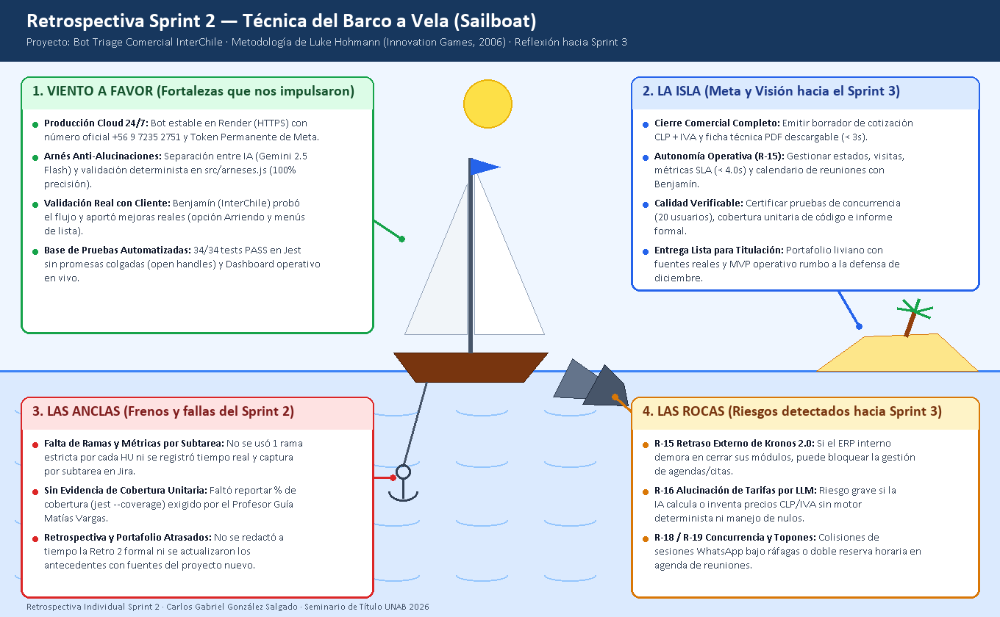

# Retrospectiva del Sprint 2 (Hito 2) — Técnica del Barco a Vela (*Sailboat*)

- **Proyecto:** Agente Conversacional Inteligente de Triage Comercial y Pre-Diagnóstico Técnico para InterChile Climatización
- **Autor / Rol:** Carlos Gabriel González Salgado (Equipo Unipersonal · Dev / QA / Scrum)
- **Sprint evaluado:** Sprint 2 — Núcleo Conversacional IA, Arnés Determinista y Dashboard Operativo (`39 SP` ejecutados)
- **Metodología utilizada:** Dinámica visual del **Barco a Vela (*Sailboat*)** (*Innovation Games*, Luke Hohmann, 2006) orientada a identificar aceleradores, frenos, riesgos futuros y compromisos concretos de mejora rumbo al Sprint 3.

---

## 1. Visualización de la Retrospectiva (Barco a Vela)

*Figura 1. Mapa visual de retrospectiva del Sprint 2 bajo la metáfora del Barco a Vela (Hohmann, 2006).*

---

## 2. Síntesis de los 4 Ejes de Análisis

### 1) Viento a favor (Lo que nos impulsó en el Sprint 2)
- **Producción real en Render (24/7):** El servicio quedó operando bajo HTTPS con número WhatsApp oficial (`+56 9 7235 2751`) y Token Permanente de Meta.
- **Separación estricta IA + Arnés determinista:** El diseño de `src/arneses.js` permitió aislar las reglas críticas de negocio respecto de Gemini 2.5 Flash, logrando validación estructural sin fugas.
- **Validación temprana con el cliente (Benjamín — InterChile):** El feedback directo del usuario clave detectó necesidades reales de negocio (modalidad Arriendo y uso de List Messages ante el límite de 3 botones de WhatsApp).
- **Base sólida de automatización:** Se alcanzaron `34/34` pruebas automatizadas (`PASS`) en Jest sin promesas colgadas (`open handles`) y se dejó desplegado un Dashboard web operativo.

### 2) La Isla (Hacia dónde navegamos en el Sprint 3)
- **Cierre comercial en PDF (`AAI-25`):** Emitir borradores de cotización CLP + IVA y ficha técnica descargable sin alucinaciones de precios.
- **Autonomía operativa ante `R-15` (`AAI-90`, `AAI-94`, `AAI-102`):** Operar estados de tickets, métricas SLA (`< 4.0s`) y calendario automático de reuniones con Benjamín directo en el Bot/Dashboard.
- **Calidad y concurrencia certificada (`AAI-98`):** Validar pruebas de estrés con 20 usuarios simultáneos, obtener cobertura unitaria real (`jest --coverage`) y consolidar el Informe Formal de Pruebas.
- **Portafolio listo para defensa (Semana del 07/12/2026):** Documento técnico liviano con fuentes primarias verificadas y MVP estable.

### 3) Las Anclas (Frenos y errores cometidos en el Sprint 2)
- **Falta de trazabilidad granular en Git y Jira:** No se aplicó una rama dedicada por cada Historia de Usuario ni se registró el tiempo real y captura de evidencia al cerrar cada subtarea en Jira.
- **Ausencia de evidencia formal de cobertura de código:** Aunque existían 34 pruebas en Jest, no se generó el reporte de cobertura unitaria (`--coverage`) ni una matriz formal separada, observación levantada por el Profesor Guía (Matías Vargas).
- **Documentación y fundamentación rezagada:** La retrospectiva formal del Sprint 2 y la actualización bibliográfica de antecedentes tras el cambio de proyecto se postergaron hasta el cierre del Hito 2.

### 4) Las Rocas (Riesgos detectados en el horizonte del Sprint 3)
- **`R-15` Retraso externo de Kronos 2.0:** Dependencia con el ERP interno que podría bloquear el flujo de agendamientos si no se sostiene la contingencia autónoma en el Dashboard.
- **`R-16` Alucinación numérica en cotizaciones CLP/IVA:** Riesgo crítico si se permite al LLM estimar valores sin pasar por reglas deterministas ni retornar `null` ante datos por confirmar.
- **`R-17` Memoria/latencia PDF (`AAI-25`), `R-18` Concurrencia (`AAI-98`) y `R-19` Topones horarios (`AAI-102`):** Riesgos técnicos de desempeño en Render, colisiones bajo ráfagas en WhatsApp y doble reserva en la agenda de reuniones de Benjamín.

---

## 3. Plan de Acción y Compromiso de Mejora Continua hacia el Sprint 3

Para evitar que los compromisos queden en declaraciones generales, la siguiente tabla define **acciones concretas, medibles y auditables** que serán evaluadas obligatoriamente en la **Retrospectiva del Sprint 3**:

| ID | Ancla / Problema Detectado | Compromiso de Mejora (Acción Concreta en Sprint 3) | Evidencia Verificable en Retrospectiva 3 | Estado Inicial |
|---|---|---|---|---|
| **CM-01** | Trabajo sin rama dedicada por HU ni registro horario por subtarea. | Trabajar estrictamente **1 rama Git por HU** (`feat/AAI-XX-...`) y registrar al cierre de cada subtarea en Jira el **tiempo real (`worklog`)**, SHA del commit y **captura de pantalla adjunta**. | 5 ramas diferenciadas en GitHub y 100% de las subtareas cerradas en Jira con `worklog` real y archivo PNG adjunto. | **En curso** (aplicado desde `AAI-25`) |
| **CM-02** | Falta de reporte de cobertura de pruebas unitarias e informe separado. | Ejecutar `npx jest --coverage` sobre módulos puros (`cotizador.js`, `pdfGenerator.js`, `arneses.js`, etc.) y redactar el documento separado `docs/INFORME_DE_PRUEBAS_SPRINT_3.md` con trazabilidad `HU → CA → Test → Evidencia`. | Salida oficial de cobertura Jest archivada + documento `INFORME_DE_PRUEBAS_SPRINT_3.md` al 100% PASS. | **Planificado** (`AAI-89` y `AAI-98`) |
| **CM-03** | Exposición a demora externa de Kronos 2.0 (`R-15`) y riesgo de topones en citas. | Consolidar la autonomía total del flujo en `public/dashboard.html` (estados, PDF, métricas SLA y calendario de reuniones para Benjamín sin doble reserva) manteniendo el adaptador `KRON2-152` desacoplado. | Pruebas de integración E2E exitosas de agenda anti-topones y descarga PDF 100% operativa sin depender de terceros. | **Planificado** (`AAI-90`, `AAI-94`, `AAI-102`) |
| **CM-04** | Retraso en actualización de antecedentes con fuentes APA y riesgos por sprint. | Actualizar anticipadamente el análisis del problema con citas reales verificadas (Canvas) y mantener la **Matriz de Riesgos** viva por sprint diferenciando riesgos abiertos de mitigados. | Avance fundamentado entregado previo a la revisión docente y riesgos `R-15`..`R-18` actualizados honestamente al cierre. | **Ejecutado parcialmente** (Paso 1A y 1B) |
